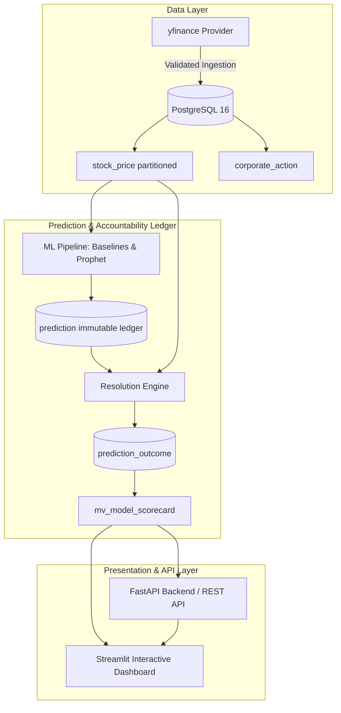

# STOCK&PREDICT

[](https://github.com/atanu-sarkar/stock-predict-app)
[](https://www.python.org/)
[](https://www.postgresql.org/)
[](https://fastapi.tiangolo.com/)
[](LICENSE)

An institutional-grade stock direction prediction and model accountability platform for Indian equities (NSE/BSE). Every prediction is permanently sealed in an immutable PostgreSQL ledger, evaluated against real market observations without look-ahead bias, and benchmarked against baseline models on identical sample sets.



## Quickstart

### Prerequisites
- Python 3.11
- PostgreSQL 16 (or local PostgreSQL service) / Docker Compose

### 1. Installation & Environment Setup

```bash
python -m venv .venv
# On Windows:
.venv\Scripts\activate
# On Linux/macOS:
source .venv/bin/activate

pip install -r requirements.txt
cp .env.example .env
```

### 2. Database Initialization & Migrations

```bash
# Initialize roles and target database
python db/init_roles.py

# Run migrations
python db/migrate.py
```

### 3. Start Backend & Verification

```bash
uvicorn app.main:app --reload
```

Health check:
```bash
curl http://localhost:8000/health
# Response: {"db": "ok"}
```

### 4. Run Tests

```bash
pytest -v
```
