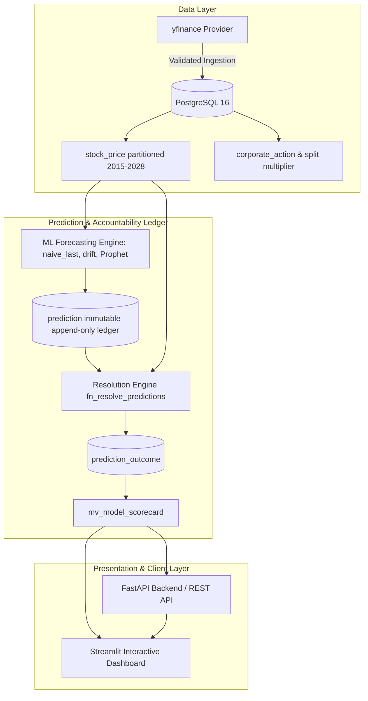

# STOCK&PREDICT

[](https://github.com/atanu-sarkar/stock-predict-app)
[](https://www.python.org/)
[](https://www.postgresql.org/)
[](https://fastapi.tiangolo.com/)
[](https://streamlit.io/)
[](https://www.gnu.org/licenses/agpl-3.0)

An institutional-grade stock direction prediction and model accountability platform for Indian equities (NSE/BSE). Every forecast is permanently recorded in a write-only, immutable PostgreSQL ledger, evaluated against actual market observations without look-ahead bias, and benchmarked against baseline models (`naive_last`, `drift`, and `Prophet`).

---

## Architecture



---

## Technology Stack

- **Backend Framework**: FastAPI & Uvicorn
- **Frontend Dashboard**: Streamlit & Plotly
- **Database Engine**: PostgreSQL 16 (range-partitioned tables, immutability triggers, materialized views)
- **Database Driver**: Psycopg 3 with Connection Pooling (`psycopg_pool`)
- **Data Provider**: yfinance with abstract provider interface
- **Analytical & ML Libraries**: pandas, NumPy, scikit-learn, Facebook Prophet
- **Testing & Verification**: pytest, HTTPX

---

## Standard Startup Workflow

Run the complete stack locally with minimal commands:

```bash
# 1. Start database container (or local PostgreSQL)
docker compose up -d db

# 2. Run schema migrations
python db/migrate.py

# 3. Seed reference data, tickers, calendar, and baseline models
python db/seed.py

# 4. Start FastAPI backend (Port 8000)
uvicorn app.main:app --reload

# 5. Start Streamlit interactive dashboard (Port 8501)
streamlit run streamlit_app.py
```

### Access URLs
- **FastAPI Documentation**: [http://localhost:8000/docs](http://localhost:8000/docs)
- **Health Check Endpoint**: [http://localhost:8000/health](http://localhost:8000/health) (returns `{"db":"ok"}`)
- **Streamlit Interactive UI**: [http://localhost:8501](http://localhost:8501)

---

## Installation & Setup Details

### 1. Prerequisites
- Python 3.11
- PostgreSQL 16 or Docker Desktop

### 2. Virtual Environment Setup
```bash
# Windows
py -3.11 -m venv .venv
.\.venv\Scripts\activate

# Linux / macOS
python3.11 -m venv .venv
source .venv/bin/activate

pip install -r requirements.txt
pip install -r requirements-dev.txt
```

### 3. Environment Configuration
Copy `.env.example` to `.env` and configure your credentials:
```bash
cp .env.example .env
```

### 4. Running Historical Ingestion
To perform historical backfill across the 10 seeded NSE equities:
```bash
python ingest/backfill.py
```

### 5. Running Test Suite
```bash
pytest -v
```

---

## Repository Structure

```text
STOCK&PREDICT/
├── app/
│   ├── config.py                 # Pydantic settings management
│   ├── db.py                     # Connection pooling (psycopg 3) & health checks
│   ├── main.py                   # FastAPI application & GET /health
├── ingest/
│   ├── providers/
│   │   ├── base.py               # Abstract market data provider
│   │   └── yfinance_provider.py  # Yahoo Finance adapter (NSE/BSE)
│   ├── validate.py               # OHLC and volume validation rules
│   ├── pipeline.py               # Transactional ingestion & reject tracking
│   ├── worker.py                 # SKIP LOCKED job queue worker
│   └── backfill.py               # Historical backfill runner
├── ml/
│   ├── features.py               # Log returns & direction classification
│   ├── models/
│   │   ├── naive_last.py         # Tomorrow = Today baseline
│   │   ├── drift.py              # Linear drift baseline
│   │   └── prophet_model.py      # Facebook Prophet forecaster
│   ├── predict.py                # Prediction service without look-ahead bias
│   ├── resolve.py                # Outcome grading and resolution
│   └── scorecards.py             # Scorecards & pandas independent validation
├── db/
│   ├── init/
│   │   └── 000_roles.sh          # Container role initialization
│   ├── migrations/
│   │   ├── 001_core.sql          # Core tables, stock_price partitions
│   │   ├── 002_model.sql         # Model catalog & versions
│   │   ├── 005_ingestion_queue.sql # Reject ledger & job queue
│   │   ├── 007_ledger.sql        # Immutable prediction ledger & triggers
│   │   ├── 008_grants.sql        # Least-privilege role permissions
│   │   ├── 009_resolution.sql    # Prediction outcome & auto-resolve trigger
│   │   └── 010_scorecards.sql    # Materialized view & skill scores
│   ├── init_roles.py             # Cross-platform role setup
│   ├── migrate.py                # Ordered repeatable migration runner
│   └── seed.py                   # Reference data, calendar & model seeding
├── tests/
│   ├── unit/
│   │   └── test_phase0.py        # Bootstrap & health tests
│   └── integration/
│       ├── test_phase1.py        # Schema constraints & partitions tests
│       ├── test_phase2.py        # Ingestion idempotency & rejects tests
│       ├── test_phase3.py        # Ledger immutability & validation tests
│       └── test_phase4.py        # Resolution, scorecards, & Prophet tests
├── docs/
│   ├── SPEC.md                   # System technical specification
│   ├── PRD.md                    # Product requirements document
│   ├── database.md               # Entity relationship & database reference
│   └── ml_methodology.md         # Quantitative evaluation methodology
├── streamlit_app.py              # Interactive Streamlit dashboard
├── docker-compose.yml            # PostgreSQL 16 container definition
├── Dockerfile                    # Container build configuration
├── requirements.txt              # Production dependencies
├── requirements-dev.txt          # Development dependencies
├── .env.example                  # Safe configuration placeholders
├── CHANGELOG.md                  # Detailed chronological release log
├── VERSION                       # Current version tag
└── LICENSE                       # GNU AGPLv3 License
```

---

## Data Sources & Responsible Use Disclaimer

- Market data is retrieved via Yahoo Finance (`yfinance`). Market observations may exhibit corporate-action adjustments, exchange anomalies, or rate limits.
- **Disclaimer**: This software is intended strictly for academic, research, and educational purposes. Model outputs do NOT constitute financial advice, buy/sell recommendations, or guaranteed returns.

---

## License

This project is licensed under the **GNU Affero General Public License v3.0 only** (`AGPL-3.0-only`). See [LICENSE](LICENSE) for details.
